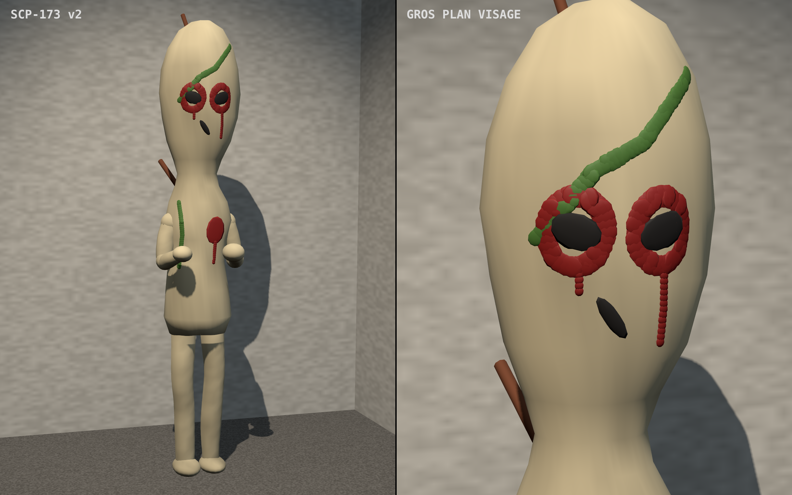

# SCP-ROBLOX

Jeu d'horreur coopératif Roblox : des Classe D traversent un Site de la Fondation SCP
en brèche, salle après salle (salles générées aléatoirement, un SCP différent à survivre à chaque fois).

- 📄 **Concept complet, bestiaire et catalogue de décors** : [`docs/CONCEPT.md`](docs/CONCEPT.md)

## Contenu actuel : SCP-173 jouable

| Fichier | Type dans Roblox Studio | Où le mettre |
|---|---|---|
| `src/ServerStorage/SCP173Model.lua` | **ModuleScript** nommé `SCP173Model` | `ServerStorage` |
| `src/ServerScriptService/SCP173AI.server.lua` | **Script** | `ServerScriptService` |
| `src/StarterPlayerScripts/BlinkAndWatch.client.lua` | **LocalScript** | `StarterPlayer > StarterPlayerScripts` |

### Modèle 3D v2 (recommandé)

1. Dans Studio : onglet **Accueil > Importer 3D**, choisis `assets/SCP173.obj`.
2. Renomme le Model importé **`SCP173Mesh`** et glisse-le dans **ServerStorage**.
3. C'est tout : le script applique couleurs, matériaux et taille (~10 studs) automatiquement.
   Sans ce modèle, l'ancienne version en blocs (v1) est utilisée.

Le mesh est généré par code (`tools/scp173-mesh/`, three.js) : 5 pièces (corps, peinture noire/rouge/verte, armature), < 10 000 triangles chacune.

### Tester dans Studio
1. Crée les 3 scripts ci-dessus et colle le contenu de chaque fichier.
2. (Optionnel) Ajoute une Part nommée `SCP173Spawn` dans le Workspace pour choisir où il apparaît.
3. Lance **Play** : SCP-173 apparaît. Tant que tu le regardes, il est figé.
   Tourne la tête ou cligne des yeux (jauge en bas, touche **B**) → il fonce sur toi.

Les sons sont à brancher dans `CONFIG` en haut de `SCP173AI` (`SCRAPE_SOUND_ID`, `SNAP_SOUND_ID`).

## Crédits / licence
Contenu basé sur la [Fondation SCP](https://scp-wiki.wikidot.com), sous licence CC BY-SA 3.0.
Le modèle de SCP-173 reprend la silhouette connue (tête allongée, petits bras, peinture) mais avec ses propres détails : la sculpture d'origine d'Izumi Kato n'est **pas** sous licence libre, donc pas de copie exacte.
